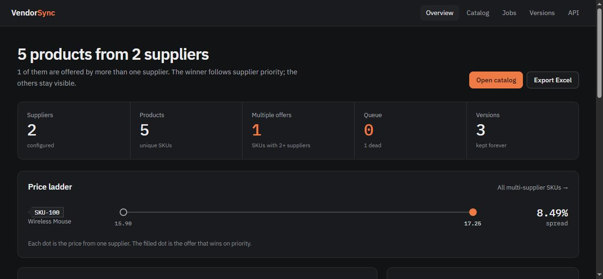
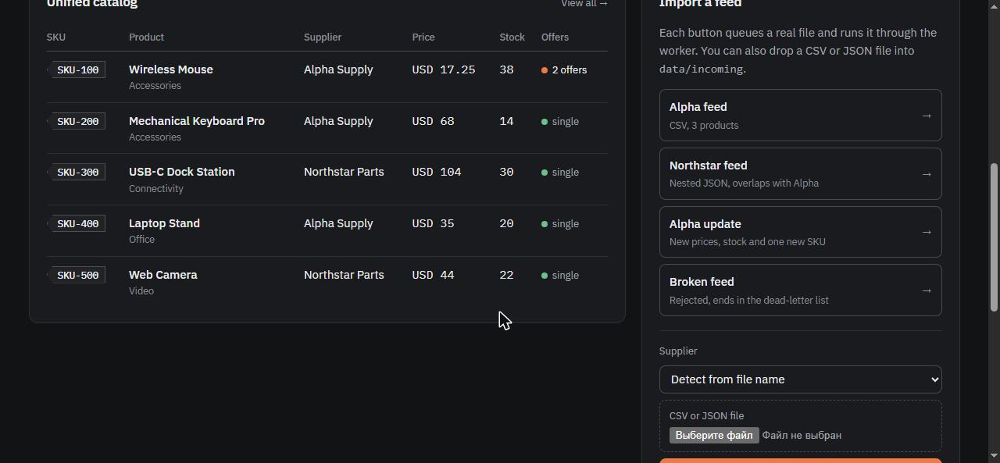
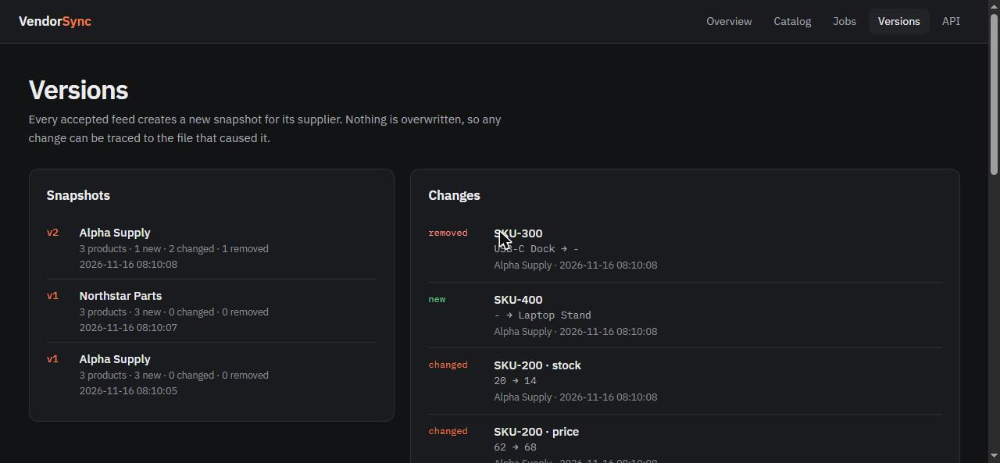
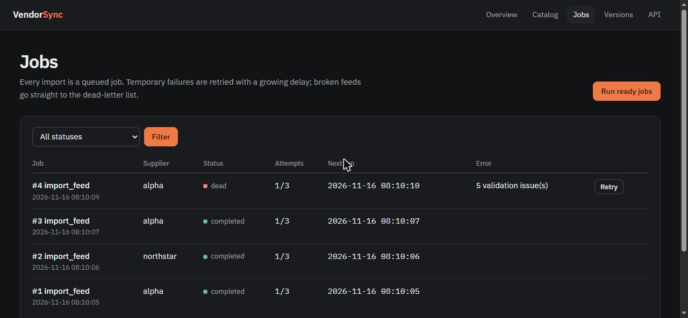
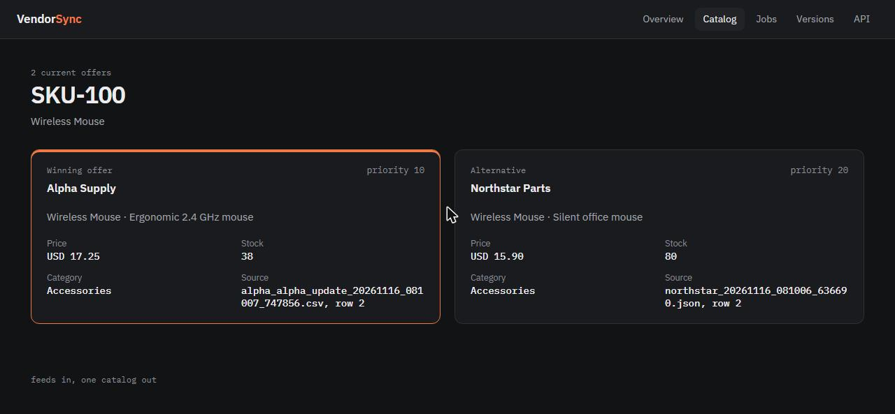
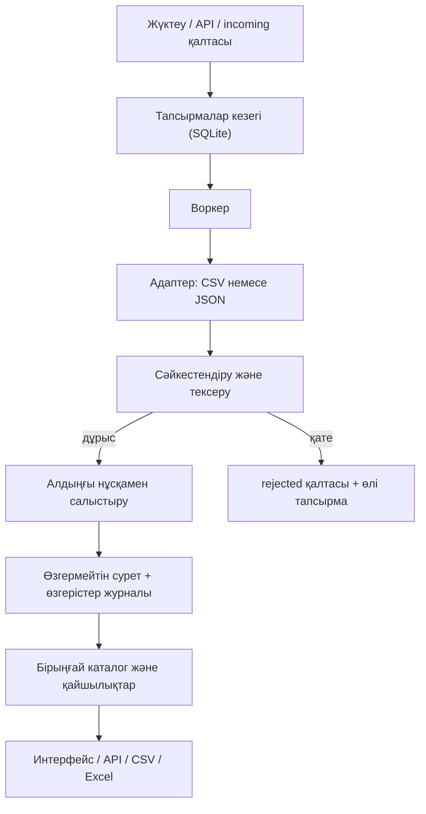

<div align="center">

# VendorSync Hub

**Жеткізушілердің фидтері кіреді, бір сенімді каталог шығады.**

Әр жеткізушінің CSV және JSON файлдары бір схемаға келтіріледі, нұсқаланады және салыстырылады, баға айырмашылығы қатар көрінеді.


[English](README.md) · [Русский](README.ru.md) · **Қазақша**

</div>



## Не істейді

Әр жеткізуші каталогты өз пішімінде жібереді. Біреуінде артикул `item_code` деп аталады, екіншісінде баға `pricing.amount` ішінде жатады. VendorSync Hub екеуін де оқиды, бір тауар схемасына келтіреді, әр жолды тексереді және қабылданған әр файлды өзгермейтін нұсқа ретінде сақтайды. Бірыңғай каталог әр жеткізушінің соңғы нұсқасынан құралады. Бір SKU екі жеткізушіде болса, екі бағаны, олардың айырмасын және қай ұсыныстың жеңетінін көресіз.

```text
Alpha CSV                 Northstar JSON               Бірыңғай тауар
item_code            ->   sku                    ->    sku
description          ->   title                  ->    name
cost                 ->   pricing.amount         ->    price
available            ->   inventory.qty          ->    stock
```

## Мүмкіндіктер

| Бағыт | Не бар |
|---|---|
| Қабылдау | Интерфейс немесе API арқылы жүктеу не `data/incoming` қалтасына файл тастау. Қалта бақыланады, файл өзгеруін тоқтатқанда өңдеуге алынады. |
| Өрістерді сәйкестендіру | Әр жеткізуші үшін `config.toml` ішінде өз өрістері, CSV және кіріктірілген JSON, жеткізуші файл атынан анықталады. |
| Тексеру | Міндетті өрістер, кез келген аймақтық пішімдегі баға (`1,234.50`, `1.234,50`, `1 234,50`), бүтін қалдық, үш әріпті валюта, бір файлдағы қайталанған SKU. |
| Қауіпсіздік | Нақты көшірме файлдар SHA-256 бойынша қабылданбайды, көлем шегі жүктеу кезінде тексеріледі, CSV және Excel ішіндегі формулалар залалсыздандырылады. |
| Нұсқалар | Қабылданған әр фид жаңа сурет пен жолдық өзгерістер тізімін береді: жаңа, өзгерген, жойылған. |
| Қайшылықтар | Жеткізуші басымдығы бойынша жеңімпаз, баға айырмасы пайызбен, валюта сәйкессіздігі белгіленеді. |
| Кезек | SQLite-тағы тұрақты кезек, өсетін үзілісті қайталаулар, «өлі» тапсырмалар тізімі, қолмен қайталау. Ақаудан кейін орындалуда қалған тапсырмалар кезекке оралады. |
| Шығыс | Веб-интерфейс, Swagger бар REST API, CSV және бірнеше парақты пішімделген Excel есебі. |

## Экрандар

| Каталог және импорт | Нұсқалар |
|---|---|
|  |  |

| Тапсырмалар | Бір SKU, барлық ұсыныс |
|---|---|
|  |  |

## Қалай жұмыс істейді



## Осы нұсқада не жаңа

| Не | Қазір қалай жұмыс істейді |
|---|---|
| Қалтадан қабылдау | `data/incoming` ішіндегі файлдар `settle_seconds` өткен соң өздігінен кезекке қойылады, сондықтан әлі көшіріліп жатқан файл жарты күйінде оқылмайды. |
| Ақаудан кейін қалпына келу | `job_timeout_seconds` уақытынан ұзақ `running` күйінде тұрған тапсырма кезекке қайтарылады, әрекеттер таусылса «өлі» тізімге түседі. |
| Аймақтық бағалар | `1.234,50`, `1,234.50` және `1 234,50` бәрі 1234.50 болып оқылады. |
| Бір уақытта бір воркер | Фондық цикл мен сұраныс ортақ құлыпты пайдаланады, сондықтан өңдеуді іске қосқан сұраныс өз тапсырмасының аяқталғанын көреді. |
| Ерекше SKU | `/`, `#` және бос орын бар SKU тауар бетінде және API-да ашылады. |
| Реттелген қосылымдар | SQLite-тың әр қосылымы қолданылғаннан кейін жабылады. |
| Health | `/health` күйді, жеткізушілер санын және кезек жағдайын сервер жолдарынсыз көрсетеді. |
| Интерфейс | Жаңа макет: бірнеше жеткізушісі бар SKU үшін баға баспалдағы, бирка түріндегі SKU, ашық және қараңғы тақырыптар. |

## Жылдам бастау

```bat
python -m venv .venv
.venv\Scripts\activate
pip install -r requirements.txt
python seed_demo.py
python run.py
```

`http://127.0.0.1:8000` мекенжайын ашыңыз. Swagger: `/docs`. Docker арқылы: `docker compose up --build`.

## Баптау

`config.toml` ішінде параметрлер және әр жеткізушіге бір блок бар.

```toml
[app]
scan_interval_seconds = 1.0     # воркер жұмысты қаншалықты жиі іздейді
settle_seconds = 2              # файл осынша секунд өзгермеуі керек
job_timeout_seconds = 300       # осыдан ұзақ орындалуда тұрған тапсырма қайтарылады
max_job_attempts = 3
max_file_size_mb = 20
conflict_price_threshold_percent = 20

[[suppliers]]
id = "northstar"
name = "Northstar Parts"
priority = 20                   # сан кіші болса, басымдық жоғары
filename_pattern = "(?i).*northstar.*\\.json$"
format = "json"

[suppliers.mapping]
sku = "sku"
name = "title"
price = "pricing.amount"        # нүкте арқылы кіріктірілген JSON өрістеріне жетеді
stock = "inventory.qty"
```

## REST API

| Әдіс | Мекенжай | Мақсаты |
|---|---|---|
| `GET` | `/health` | Күй және кезек |
| `GET` | `/api/stats` | Қорытындылар |
| `GET` | `/api/suppliers` | Жеткізуші баптаулары |
| `POST` | `/api/feeds/upload` | CSV немесе JSON жүктеу (`run_now=false` тек кезекке қояды) |
| `GET` | `/api/jobs` | Кезек |
| `POST` | `/api/jobs/run` | Дайын тапсырмаларды іске қосу |
| `POST` | `/api/jobs/{id}/retry` | Өлі немесе қайталанатын тапсырманы қайталау |
| `GET` | `/api/catalog` | Бірыңғай каталог |
| `GET` | `/api/products/{sku}` | SKU бойынша барлық ағымдағы ұсыныс |
| `GET` | `/api/versions` | Нұсқалар тарихы |
| `GET` | `/api/conflicts` | Бірнеше жеткізушісі бар SKU және баға айырмасы |
| `GET` | `/exports/catalog.csv` | Каталог CSV пішімінде |
| `GET` | `/exports/catalog.xlsx` | Excel толық есебі |

## Тесттер

```bat
pip install -r requirements.txt
python -m pytest -q
```

30 тест импортты, қабылдамауды, қайталауларды, өлі тапсырмаларды, ақаудан кейін қалпына келуді, қалтадан қабылдауды, аймақтық бағаларды, қайшылықтарды, экспортты және API-ды қамтиды. Барлығы желісіз, уақытша SQLite файлында жұмыс істейді.

## Құрылым

```text
app/        адаптерлер, каталог (салыстыру және қайшылықтар), конфигурация, база, импорт, воркер, веб
data/       incoming, archive, rejected
docs/       архитектура, жоспар, скриншоттар
tests/      модульдік, сценарийлік және API тесттері
config.toml жеткізушілер және баптаулар
```

## Автор

Koncha Artyom, [github.com/artyom129](https://github.com/artyom129). Бэкенд және автоматтандыру бойынша фрилансқа ашықпын.

## Лицензия

MIT
