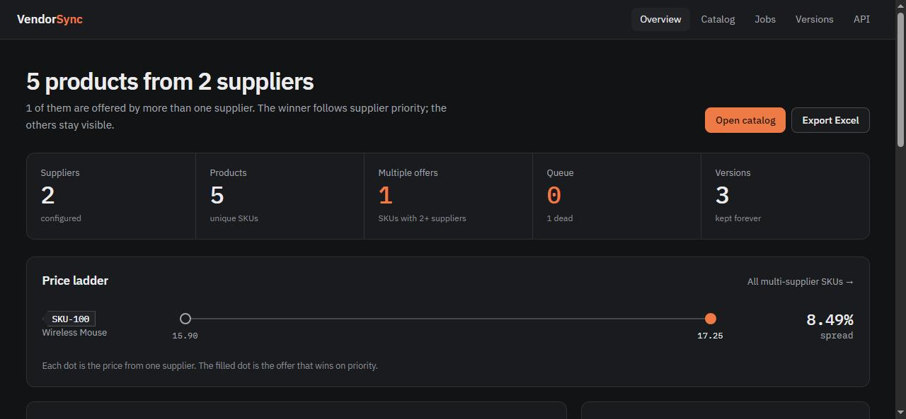
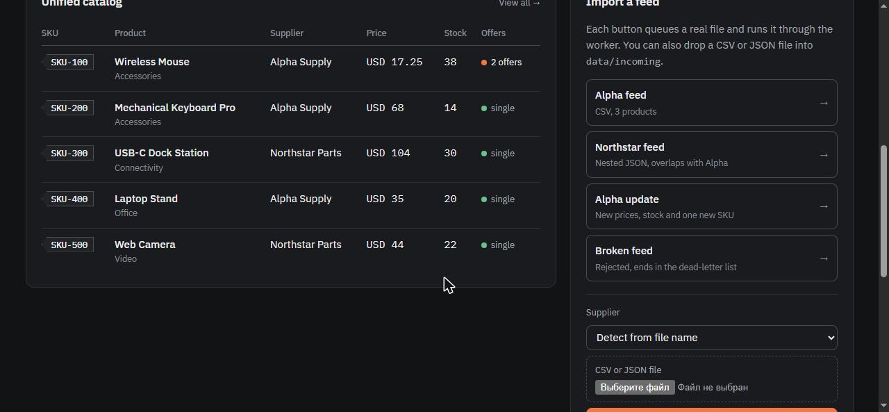
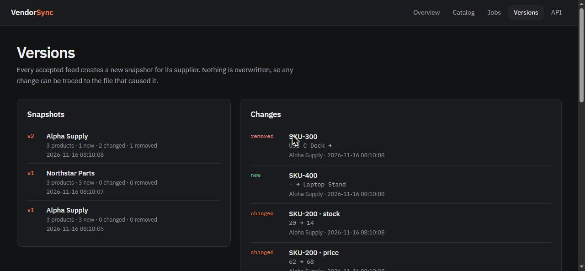
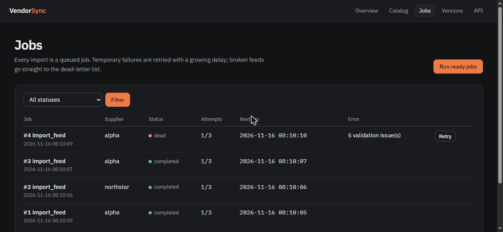
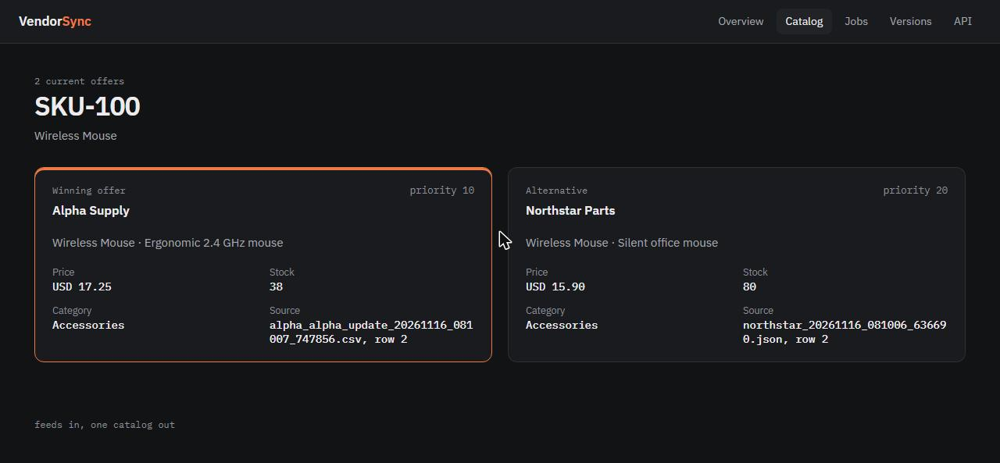
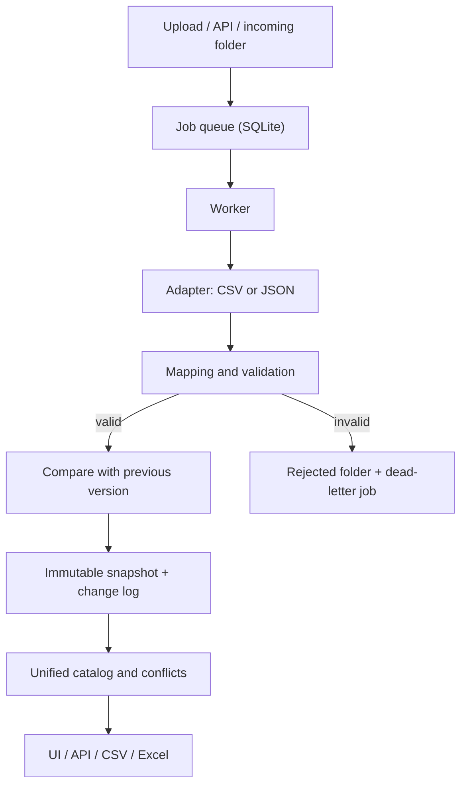

<div align="center">

# VendorSync Hub

**Supplier feeds in, one trustworthy catalog out.**

CSV and JSON from every supplier, normalized, versioned and compared, with price conflicts shown side by side.


**English** · [Русский](README.ru.md) · [Қазақша](README.kk.md)

</div>



## What it does

Every supplier sends a catalog in its own shape. One calls the SKU `item_code`, another nests the price under `pricing.amount`. VendorSync Hub reads both, maps them to one product schema, checks every row, and keeps each accepted file as an immutable version. The unified catalog is built from the latest version of each supplier, and when two suppliers offer the same SKU you see both prices, the spread between them and which offer wins.

```text
Alpha CSV                 Northstar JSON               Canonical product
item_code            ->   sku                    ->    sku
description          ->   title                  ->    name
cost                 ->   pricing.amount         ->    price
available            ->   inventory.qty          ->    stock
```

## Features

| Area | What you get |
|---|---|
| Intake | Upload in the web UI or the API, or drop a file into `data/incoming`. The folder is watched and a file is picked up once it stops changing. |
| Mapping | Per-supplier field mapping in `config.toml`, CSV and nested JSON, supplier detected from the file name. |
| Validation | Required fields, decimal prices in any regional format (`1,234.50`, `1.234,50`, `1 234,50`), whole-number stock, three-letter currency, duplicate SKUs in one file. |
| Safety | Exact duplicate files are refused by SHA-256, size limit enforced while streaming, spreadsheet formulas neutralized in CSV and Excel exports. |
| Versions | Every accepted feed is a new snapshot with field-level changes: new, changed, removed. |
| Conflicts | Winner by supplier priority, price spread in percent, currency mismatches flagged. |
| Queue | Persistent SQLite job queue, retries with growing delay, dead-letter list, manual retry. Jobs left running by a crash are recovered. |
| Output | Web UI, REST API with Swagger, CSV, and a formatted multi-sheet Excel report. |

## Screens

| Catalog and import | Versions |
|---|---|
|  |  |

| Jobs | One SKU, every offer |
|---|---|
|  |  |

## How it works



## What is new in this version

| What | How it works now |
|---|---|
| Folder intake | Files placed in `data/incoming` are queued automatically after `settle_seconds`, so a copy in progress is never read half written. |
| Crash recovery | A job that has been `running` longer than `job_timeout_seconds` is put back in the queue, or in the dead-letter list when its attempts are used up. |
| Regional prices | `1.234,50`, `1,234.50` and `1 234,50` all read as 1234.50. |
| One worker at a time | The background loop and a request share one lock, so a request that triggers a run always sees its job finished. |
| Odd SKUs | SKUs with `/`, `#` or spaces open correctly on the product page and in the API. |
| Tidy connections | Every SQLite connection is closed after use. |
| Health | `/health` reports status, supplier count and queue state without server paths. |
| Interface | New layout with a price ladder for multi-supplier SKUs, hang-tag SKUs, light and dark themes. |

## Quick start

```bat
python -m venv .venv
.venv\Scripts\activate
pip install -r requirements.txt
python seed_demo.py
python run.py
```

Open `http://127.0.0.1:8000`. Swagger is at `/docs`. With Docker: `docker compose up --build`.

## Configuration

`config.toml` holds the settings and one block per supplier.

```toml
[app]
scan_interval_seconds = 1.0     # how often the worker looks for work
settle_seconds = 2              # a dropped file must be unchanged this long
job_timeout_seconds = 300       # a running job older than this is recovered
max_job_attempts = 3
max_file_size_mb = 20
conflict_price_threshold_percent = 20

[[suppliers]]
id = "northstar"
name = "Northstar Parts"
priority = 20                   # lower number wins
filename_pattern = "(?i).*northstar.*\\.json$"
format = "json"

[suppliers.mapping]
sku = "sku"
name = "title"
price = "pricing.amount"        # dotted paths reach into nested JSON
stock = "inventory.qty"
```

## REST API

| Method | Endpoint | Purpose |
|---|---|---|
| `GET` | `/health` | Status and queue state |
| `GET` | `/api/stats` | Totals |
| `GET` | `/api/suppliers` | Supplier configuration |
| `POST` | `/api/feeds/upload` | Upload CSV or JSON (`run_now=false` to only queue) |
| `GET` | `/api/jobs` | Queue |
| `POST` | `/api/jobs/run` | Run ready jobs |
| `POST` | `/api/jobs/{id}/retry` | Retry a dead or retrying job |
| `GET` | `/api/catalog` | Unified catalog |
| `GET` | `/api/products/{sku}` | Every current offer for a SKU |
| `GET` | `/api/versions` | Version history |
| `GET` | `/api/conflicts` | Multi-supplier SKUs with spread |
| `GET` | `/exports/catalog.csv` | Catalog as CSV |
| `GET` | `/exports/catalog.xlsx` | Full Excel report |

## Tests

```bat
pip install -r requirements.txt
python -m pytest -q
```

30 tests cover import, rejection, retries, dead letters, crash recovery, folder intake, regional prices, conflicts, exports and the API. Everything runs offline on a temporary SQLite file.

## Project layout

```text
app/        adapters, catalog (compare and conflicts), config, database, importer, worker, web
data/       incoming, archive, rejected
docs/       architecture, roadmap, screenshots
tests/      unit, workflow and API tests
config.toml suppliers and settings
```

## Author

Built by [Koncha Artyom](https://github.com/artyom129). Open to freelance backend and automation work.

## License

MIT
