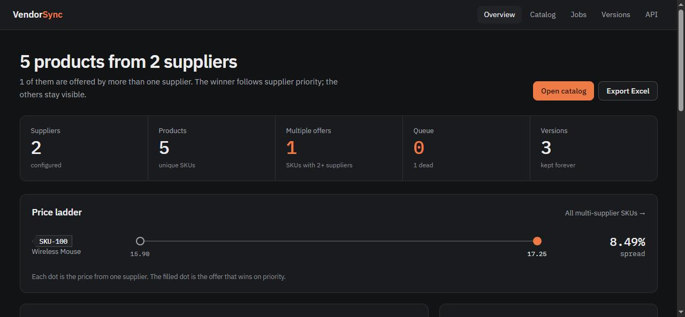
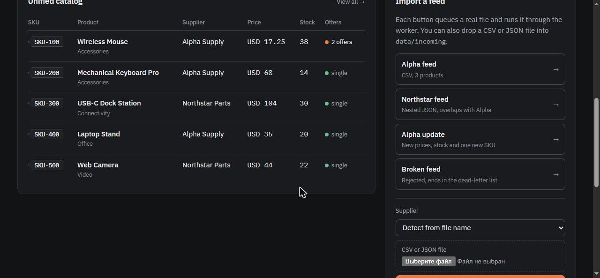
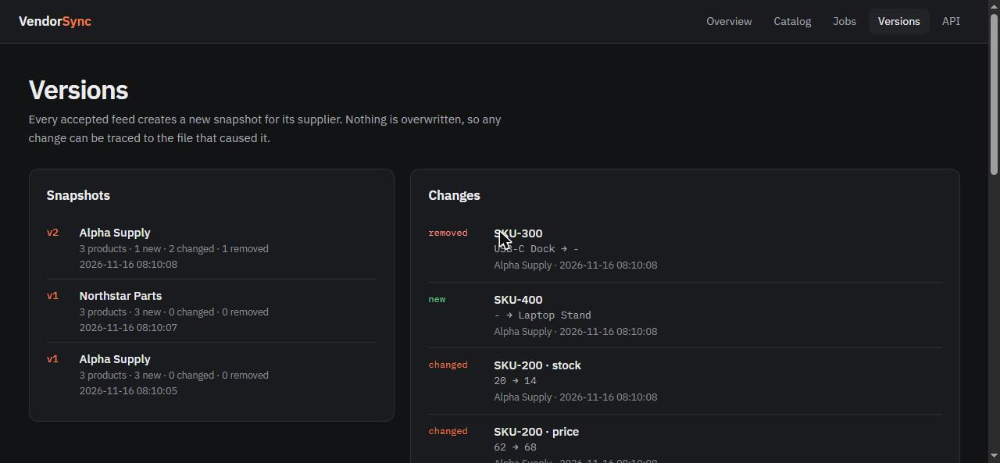
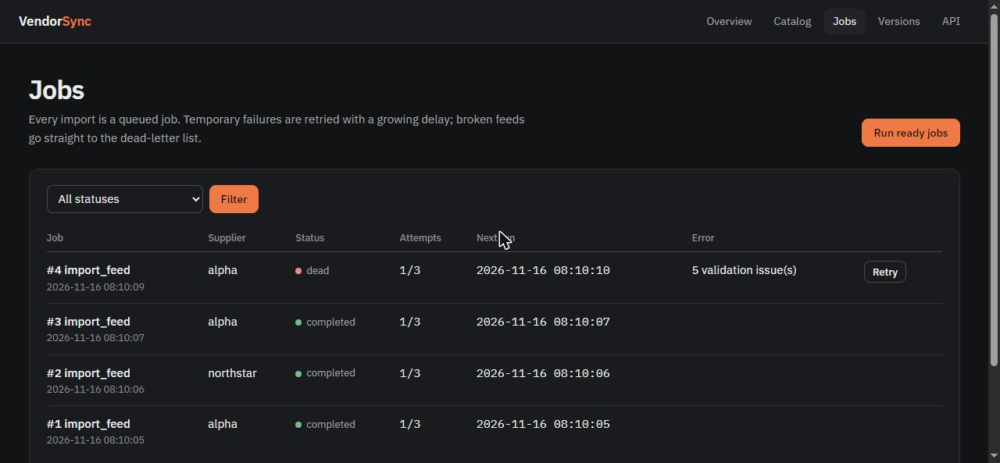
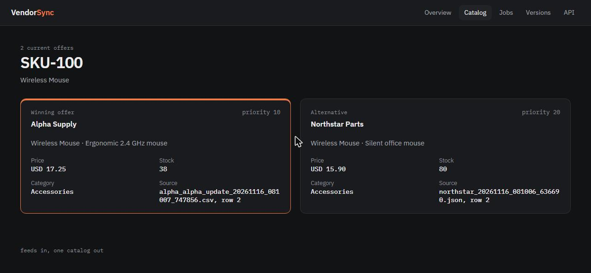
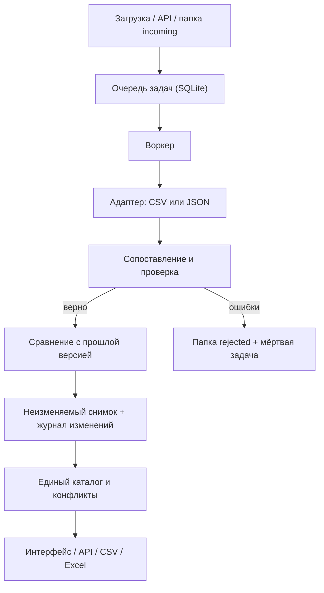

<div align="center">

# VendorSync Hub

**Фиды поставщиков на входе, один надёжный каталог на выходе.**

CSV и JSON от каждого поставщика: приводятся к одной схеме, версионируются и сравниваются, а расхождения в ценах видны рядом.


[English](README.md) · **Русский** · [Қазақша](README.kk.md)

</div>



## Что делает

Каждый поставщик присылает каталог в своём формате. У одного артикул называется `item_code`, у другого цена лежит в `pricing.amount`. VendorSync Hub читает оба файла, приводит их к одной схеме товара, проверяет каждую строку и сохраняет каждый принятый файл как неизменяемую версию. Общий каталог собирается из последней версии каждого поставщика, а если один и тот же SKU есть у двух поставщиков, вы видите обе цены, разницу между ними и то, какое предложение побеждает.

```text
Alpha CSV                 Northstar JSON               Единый товар
item_code            ->   sku                    ->    sku
description          ->   title                  ->    name
cost                 ->   pricing.amount         ->    price
available            ->   inventory.qty          ->    stock
```

## Возможности

| Область | Что есть |
|---|---|
| Приём | Загрузка в интерфейсе или через API, либо файл в папку `data/incoming`. Папка отслеживается, файл берётся в работу, когда перестал меняться. |
| Сопоставление полей | Свои поля для каждого поставщика в `config.toml`, CSV и вложенный JSON, поставщик определяется по имени файла. |
| Проверка | Обязательные поля, цены в любом региональном формате (`1,234.50`, `1.234,50`, `1 234,50`), целый остаток, трёхбуквенная валюта, дубли SKU в одном файле. |
| Безопасность | Точные копии файлов отклоняются по SHA-256, лимит размера проверяется при загрузке, формулы в CSV и Excel обезврежены. |
| Версии | Каждый принятый фид даёт новый снимок и построчный список изменений: новые, изменённые, удалённые. |
| Конфликты | Победитель по приоритету поставщика, разница цен в процентах, разные валюты помечаются. |
| Очередь | Постоянная очередь в SQLite, повторы с растущей паузой, список «мёртвых» задач, ручной повтор. Задачи, оставшиеся в работе после сбоя, возвращаются в очередь. |
| Выход | Веб-интерфейс, REST API со Swagger, CSV и отформатированный Excel-отчёт на несколько листов. |

## Экраны

| Каталог и импорт | Версии |
|---|---|
|  |  |

| Задачи | Один SKU, все предложения |
|---|---|
|  |  |

## Как это работает



## Что нового в этой версии

| Что | Как теперь работает |
|---|---|
| Приём из папки | Файлы из `data/incoming` ставятся в очередь сами через `settle_seconds`, поэтому недокопированный файл не читается наполовину. |
| Восстановление после сбоя | Задача, которая висит в `running` дольше `job_timeout_seconds`, возвращается в очередь, а если попытки закончились, попадает в список «мёртвых». |
| Региональные цены | `1.234,50`, `1,234.50` и `1 234,50` читаются как 1234.50. |
| Один воркер за раз | Фоновый цикл и запрос используют общую блокировку, поэтому запрос, запустивший обработку, видит свою задачу завершённой. |
| Необычные SKU | SKU со знаками `/`, `#` и пробелами открываются на странице товара и в API. |
| Аккуратные соединения | Каждое соединение SQLite закрывается после использования. |
| Health | `/health` показывает статус, число поставщиков и состояние очереди без серверных путей. |
| Интерфейс | Новая вёрстка: лестница цен для SKU с несколькими поставщиками, SKU в виде бирок, светлая и тёмная темы. |

## Быстрый старт

```bat
python -m venv .venv
.venv\Scripts\activate
pip install -r requirements.txt
python seed_demo.py
python run.py
```

Откройте `http://127.0.0.1:8000`. Swagger: `/docs`. Через Docker: `docker compose up --build`.

## Настройка

В `config.toml` лежат параметры и по одному блоку на поставщика.

```toml
[app]
scan_interval_seconds = 1.0     # как часто воркер ищет работу
settle_seconds = 2              # файл должен не меняться столько секунд
job_timeout_seconds = 300       # зависшая в работе задача старше этого возвращается
max_job_attempts = 3
max_file_size_mb = 20
conflict_price_threshold_percent = 20

[[suppliers]]
id = "northstar"
name = "Northstar Parts"
priority = 20                   # меньше число, выше приоритет
filename_pattern = "(?i).*northstar.*\\.json$"
format = "json"

[suppliers.mapping]
sku = "sku"
name = "title"
price = "pricing.amount"        # через точку доходит до вложенных полей JSON
stock = "inventory.qty"
```

## REST API

| Метод | Адрес | Назначение |
|---|---|---|
| `GET` | `/health` | Статус и очередь |
| `GET` | `/api/stats` | Итоги |
| `GET` | `/api/suppliers` | Настройки поставщиков |
| `POST` | `/api/feeds/upload` | Загрузка CSV или JSON (`run_now=false`, чтобы только поставить в очередь) |
| `GET` | `/api/jobs` | Очередь |
| `POST` | `/api/jobs/run` | Запустить готовые задачи |
| `POST` | `/api/jobs/{id}/retry` | Повторить мёртвую или повторяемую задачу |
| `GET` | `/api/catalog` | Единый каталог |
| `GET` | `/api/products/{sku}` | Все текущие предложения по SKU |
| `GET` | `/api/versions` | История версий |
| `GET` | `/api/conflicts` | SKU у нескольких поставщиков с разницей цен |
| `GET` | `/exports/catalog.csv` | Каталог в CSV |
| `GET` | `/exports/catalog.xlsx` | Полный отчёт в Excel |

## Тесты

```bat
pip install -r requirements.txt
python -m pytest -q
```

30 тестов покрывают импорт, отклонение, повторы, мёртвые задачи, восстановление после сбоя, приём из папки, региональные цены, конфликты, выгрузки и API. Всё работает без сети на временном файле SQLite.

## Структура

```text
app/        адаптеры, каталог (сравнение и конфликты), конфигурация, база, импорт, воркер, веб
data/       incoming, archive, rejected
docs/       архитектура, план, скриншоты
tests/      модульные, сценарные и API-тесты
config.toml поставщики и настройки
```

## Автор

Koncha Artyom, [github.com/artyom129](https://github.com/artyom129). Беру фриланс по бэкенду и автоматизации.

## Лицензия

MIT
